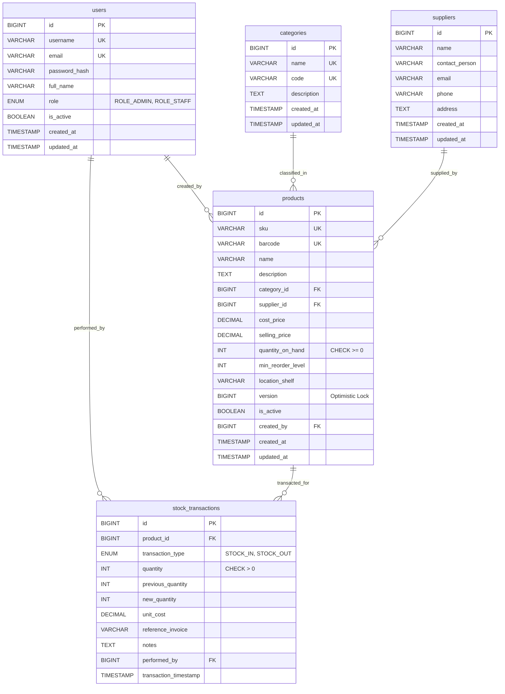

# Relational Database Design & Schema Specification
# Smart Inventory Management Mobile Application

---

## 1. Database Overview

- **RDBMS Engine:** MySQL Server 8.4 Community Edition
- **Storage Engine:** InnoDB (ACID compliant, row-level locking, foreign key enforcement)
- **Database / Schema Name:** `inventory_management`
- **Default Character Set:** `utf8mb4`
- **Default Collation:** `utf8mb4_unicode_ci`

---

## 2. Entity-Relationship (ER) Diagram

---

## 3. Data Dictionary & Detailed Table Definitions

### 1. `users` Table
Stores authentication credentials, security roles, and user profile details.

| Column Name | Data Type | Nullable | Key / Constraint | Description |
| :--- | :--- | :---: | :---: | :--- |
| `id` | `BIGINT` | No | `PRIMARY KEY AUTO_INCREMENT` | Unique user identifier |
| `username` | `VARCHAR(50)` | No | `UNIQUE` | Unique system username |
| `email` | `VARCHAR(100)`| No | `UNIQUE` | User email address for authentication |
| `password_hash` | `VARCHAR(255)`| No | None | Encrypted BCrypt password hash (cost 12) |
| `full_name` | `VARCHAR(100)`| No | None | Full legal or operational name |
| `role` | `VARCHAR(20)` | No | `CHECK (role IN ('ROLE_ADMIN', 'ROLE_STAFF'))` | Security role for RBAC permissions |
| `is_active` | `BOOLEAN` | No | `DEFAULT TRUE` | Soft-disable flag for deactivated staff |
| `created_at` | `TIMESTAMP` | No | `DEFAULT CURRENT_TIMESTAMP` | Account creation timestamp |
| `updated_at` | `TIMESTAMP` | No | `DEFAULT CURRENT_TIMESTAMP ON UPDATE` | Last modification timestamp |

---

### 2. `categories` Table
Stores product classifications for catalog filtering.

| Column Name | Data Type | Nullable | Key / Constraint | Description |
| :--- | :--- | :---: | :---: | :--- |
| `id` | `BIGINT` | No | `PRIMARY KEY AUTO_INCREMENT` | Unique category identifier |
| `name` | `VARCHAR(100)`| No | `UNIQUE` | Category title (e.g. Electronics, Tools) |
| `code` | `VARCHAR(30)` | No | `UNIQUE` | Normalized uppercase code (e.g. ELEC) |
| `description` | `TEXT` | Yes | None | Category description and notes |
| `created_at` | `TIMESTAMP` | No | `DEFAULT CURRENT_TIMESTAMP` | Creation timestamp |
| `updated_at` | `TIMESTAMP` | No | `DEFAULT CURRENT_TIMESTAMP ON UPDATE` | Last modification timestamp |

---

### 3. `suppliers` Table
Stores external vendor contact records for stock reordering.

| Column Name | Data Type | Nullable | Key / Constraint | Description |
| :--- | :--- | :---: | :---: | :--- |
| `id` | `BIGINT` | No | `PRIMARY KEY AUTO_INCREMENT` | Unique supplier identifier |
| `name` | `VARCHAR(120)`| No | None | Commercial company name |
| `contact_person`| `VARCHAR(100)`| Yes | None | Name of account manager or sales rep |
| `email` | `VARCHAR(100)`| Yes | None | Contact email address |
| `phone` | `VARCHAR(30)` | Yes | None | Vendor telephone number |
| `address` | `TEXT` | Yes | None | Physical warehouse / shipping address |
| `created_at` | `TIMESTAMP` | No | `DEFAULT CURRENT_TIMESTAMP` | Creation timestamp |
| `updated_at` | `TIMESTAMP` | No | `DEFAULT CURRENT_TIMESTAMP ON UPDATE` | Last modification timestamp |

---

### 4. `products` Table
Core inventory catalog entity tracking physical quantities, pricing, and storage bins.

| Column Name | Data Type | Nullable | Key / Constraint | Description |
| :--- | :--- | :---: | :---: | :--- |
| `id` | `BIGINT` | No | `PRIMARY KEY AUTO_INCREMENT` | Unique product identifier |
| `sku` | `VARCHAR(50)` | No | `UNIQUE, INDEX` | Unique Stock Keeping Unit code |
| `barcode` | `VARCHAR(100)`| Yes | `UNIQUE, INDEX` | EAN/UPC barcode for mobile scanning |
| `name` | `VARCHAR(150)`| No | None | Commercial product title |
| `description` | `TEXT` | Yes | None | Detailed specifications and details |
| `category_id` | `BIGINT` | No | `FOREIGN KEY (categories.id) ON DELETE RESTRICT` | Associated category |
| `supplier_id` | `BIGINT` | Yes | `FOREIGN KEY (suppliers.id) ON DELETE SET NULL` | Primary vendor supplier |
| `cost_price` | `DECIMAL(10,2)`| No | `CHECK (cost_price >= 0)` | Unit purchase cost price |
| `selling_price`| `DECIMAL(10,2)`| No | `CHECK (selling_price >= 0)`| Unit retail selling price |
| `quantity_on_hand`| `INT` | No | `CHECK (quantity_on_hand >= 0)` | Physical on-hand balance |
| `min_reorder_level`| `INT`| No | `DEFAULT 10, CHECK (>= 0)` | Automated threshold for low stock alert |
| `location_shelf`| `VARCHAR(50)` | Yes | None | Storage rack/bin tag (e.g. Aisle 3, Bin B2) |
| `is_active` | `BOOLEAN` | No | `DEFAULT TRUE` | Soft-delete flag |
| `version` | `BIGINT` | No | `DEFAULT 0` | JPA `@Version` optimistic locking counter |
| `created_by` | `BIGINT` | Yes | `FOREIGN KEY (users.id) ON DELETE SET NULL` | Creator user record |
| `created_at` | `TIMESTAMP` | No | `DEFAULT CURRENT_TIMESTAMP` | Creation timestamp |
| `updated_at` | `TIMESTAMP` | No | `DEFAULT CURRENT_TIMESTAMP ON UPDATE` | Last modification timestamp |

---

### 5. `stock_transactions` Table
Immutable, append-only financial audit ledger recording every inventory movement.

| Column Name | Data Type | Nullable | Key / Constraint | Description |
| :--- | :--- | :---: | :---: | :--- |
| `id` | `BIGINT` | No | `PRIMARY KEY AUTO_INCREMENT` | Unique ledger transaction identifier |
| `product_id` | `BIGINT` | No | `FOREIGN KEY (products.id) ON DELETE CASCADE` | Transacted product |
| `transaction_type`| `VARCHAR(20)`| No | `CHECK (transaction_type IN ('STOCK_IN', 'STOCK_OUT'))` | Movement direction |
| `quantity` | `INT` | No | `CHECK (quantity > 0)` | Number of units moved |
| `previous_quantity`| `INT` | No | None | Stock level immediately prior to movement |
| `new_quantity` | `INT` | No | None | Stock level immediately after movement |
| `unit_cost` | `DECIMAL(10,2)`| Yes | None | Unit cost at time of transaction |
| `reference_invoice`| `VARCHAR(100)`| Yes | None | Purchase order or customer invoice # |
| `notes` | `TEXT` | Yes | None | Reason details or delivery comments |
| `performed_by` | `BIGINT` | No | `FOREIGN KEY (users.id) ON DELETE RESTRICT` | Responsible authenticated user |
| `transaction_timestamp`| `TIMESTAMP`| No | `DEFAULT CURRENT_TIMESTAMP, INDEX` | Exact transaction date & time |

---

## 4. Integrity Constraints & Invariants

1. **Non-Negative Inventory Invariant:** Enforced at the RDBMS engine level via `CHECK (quantity_on_hand >= 0)`.
2. **Prevent Orphaned Transactions:** The `users` foreign key on `stock_transactions` specifies `ON DELETE RESTRICT`, preventing accidental deletion of users with recorded financial ledger entries.
3. **Pessimistic Row Serialization:** Mutating queries execute `SELECT * FROM products WHERE id = ? FOR UPDATE` to lock product records across transaction lifecycles.
