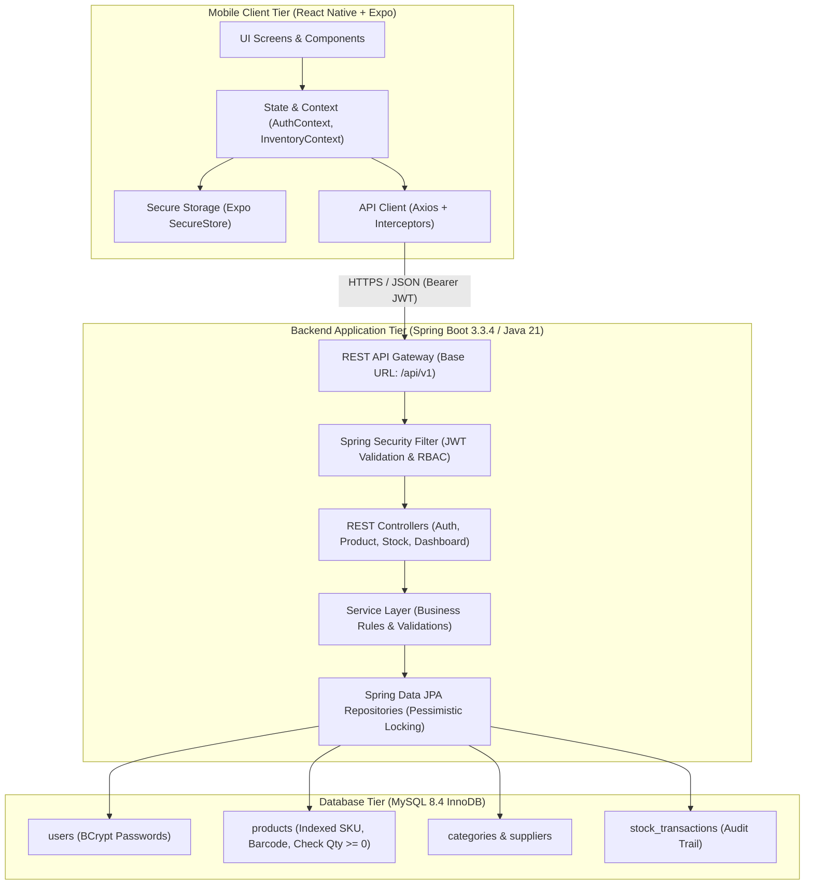
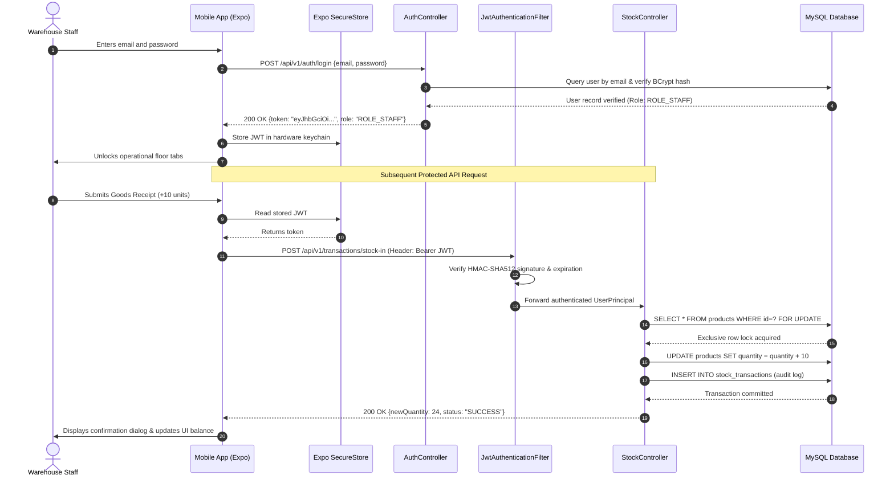

# System Architecture & Technical Design Specification
# Smart Inventory Management Mobile Application

---

## 1. High-Level Architecture Overview

The system employs a decoupled, multi-tiered client-server architecture composed of a **React Native + Expo mobile application**, a stateless **Spring Boot 3.3.4 REST API microservice**, and an ACID-compliant **MySQL 8.4 transactional database**.



---

## 2. Mobile Client Architecture (`inventory-mobile/`)

The mobile client is engineered with clean separation of concerns across 8 core modules:

```
inventory-mobile/
├── src/
│   ├── api/          # Centralized Axios client and API domain wrappers
│   ├── components/   # Reusable Atomic UI elements (AppButton, AppInput, ProductCard, etc.)
│   ├── constants/    # Environment configurations, demo data, and route keys
│   ├── context/      # Reactive application state (AuthContext, InventoryContext)
│   ├── hooks/        # Custom React hooks (useAuth, useInventory)
│   ├── navigation/   # Stack and BottomTab navigators with role-based routing
│   ├── screens/      # Domain screens (auth, dashboard, products, stock, alerts, profile)
│   ├── theme/        # Centralized design tokens (colors, typography, spacing, shadows)
│   └── utils/        # Formatters, input validators, and storage abstractions
```

### Key Architectural Invariants:
1. **Dynamic Base URL Resolution:** The API client automatically configures itself for Android Emulators (`http://10.0.2.2:8080/api/v1`), physical devices, and web browsers (`http://localhost:8080/api/v1`).
2. **Transparent Token Injection:** An Axios request interceptor pulls the active JWT from hardware-backed storage (`Expo SecureStore`) and sets `Authorization: Bearer <token>` on all outgoing calls.
3. **Graceful Network Degradation:** The response interceptor intercepts 4xx/5xx network failures and normalizes them into structured error objects without exposing raw exception traces to the user.

---

## 3. Backend Architecture (`inventory-backend/`)

The backend is built as an enterprise Spring Boot application adhering to Clean Architecture principles:

```mermaid
graph LR
    Req[Incoming HTTP Request] --> Ctrl[Controller Layer]
    Ctrl --> DTO[DTO Validation jakarta.validation]
    DTO --> Svc[Service Layer Business Logic]
    Svc --> Lock[Row-Level Lock SELECT FOR UPDATE]
    Lock --> Repo[Spring Data JPA Repository]
    Repo --> DB[(MySQL 8.4 Engine)]
    DB --> Entity[JPA Entity]
    Entity --> Mapper[Entity-to-DTO Mapper]
    Mapper --> Resp[HTTP Response 200 OK / 201 Created]
```



### Architectural Highlights:
- **Layered Decoupling:** Controllers only handle HTTP concerns and DTO binding; Services enforce business validation and transactional boundaries; Repositories manage persistence.
- **Pessimistic Concurrency Serialization:** In `StockService`, mutating stock operations acquire exclusive database row locks via `productRepository.findByIdForUpdate(productId)` with `@Transactional(isolation = Isolation.READ_COMMITTED)`. This guarantees zero inventory overdrafts during simultaneous warehouse transactions.
- **Optimistic Locking:** The `Product` entity contains `@Version private Long version`, providing secondary protection against lost updates during catalog metadata edits.

---

## 4. Authentication & Security Flow



---

## 5. API Request & Error Masking Architecture

To prevent sensitive information leakage:
1. **Centralized Exception Catching:** `@RestControllerAdvice` in `GlobalExceptionHandler.java` intercepts all thrown runtime exceptions.
2. **Safe Error Normalization:** Internal SQL exceptions or database constraint failures are translated into structured, safe responses:
   ```json
   {
     "status": 400,
     "error": "Insufficient Stock",
     "message": "Cannot dispatch 25 units. Only 14 units available on hand.",
     "path": "/api/v1/transactions/stock-out",
     "timestamp": "2026-10-21T16:20:00Z"
   }
   ```
3. **Redacted Server Logging:** Diagnostic stack traces are recorded exclusively in server-side logs with sensitive credentials (passwords, JWT secrets, authorization tokens) strictly redacted.
