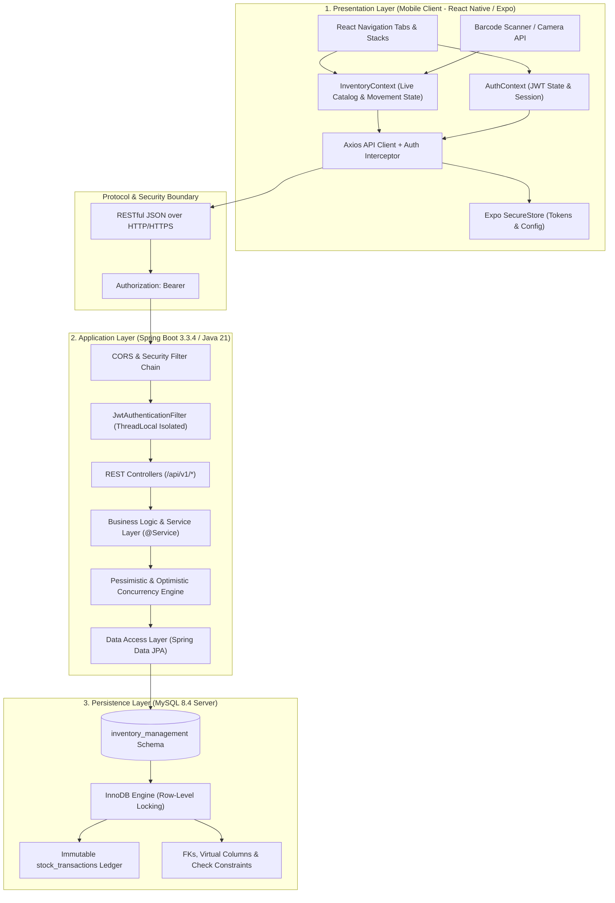

# System Architecture & Technical Design
## Smart Inventory Management Mobile Application

---

## 1. Architectural Overview

The Smart Inventory Management System is structured as a decoupled **Three-Tier Client-Server Architecture** designed for high modularity, transactional consistency, and cross-platform mobile accessibility:



---

## 2. Component Responsibilities & Module Isolation

### Tier 1: Presentation Layer — React Native + Expo Mobile Application

- **Technology**: React Native 0.88, Expo SDK 58, React Navigation 7, Axios, Expo SecureStore.
- **Key Modules**:
  1. **Navigation Architecture (`src/navigation/`)**:
     - `RootNavigator`: Conditionally renders `AuthNavigator` (Login, Register) or `MainNavigator` based on the reactive `isAuthenticated` state from `AuthContext`.
     - `MainNavigator`: Houses a 6-tab bottom navigator (`Dashboard`, `Catalog`, `Audit History`, `Stock Alerts`, `Reports`, `Profile`) and nested modal stack screens (`ProductDetail`, `AddProduct`, `EditProduct`, `StockIn`, `StockOut`, `UserManagement`).
  2. **State & Context Layer (`src/context/`)**:
     - `AuthContext`: Manages user credentials, JWT tokens, automatic session restoration from SecureStore, role detection (`isAdmin`), and standalone mock fallback for offline evaluations.
     - `InventoryContext`: Manages product list caching, category and supplier dropdown lists, stock transaction updates, and low-stock badge counting.
  3. **API Integration Client (`src/api/client.js`)**:
     - Automatically attaches `Authorization: Bearer <token>` from SecureStore to outgoing requests.
     - Intercepts and normalizes server error responses (translating 400 validation field errors, 401 session expiry, 403 access denial, 409 conflict, and 500 server faults into user-friendly messages).
     - Provides configurable Base URL management (`setBaseUrl`, `initBaseUrl`) enabling switching between Android Emulator (`10.0.2.2:8080`), local Wi-Fi IPs, and `localhost`.
  4. **Reusable UI Design System (`src/components/`, `src/theme/`)**:
     - Cohesive visual tokens (`colors`, `typography`, `spacing`, `borderRadius`, `shadows`).
     - Premium touch components: `AppButton`, `AppInput`, `ProductCard`, `ErrorMessage`, `LoadingView`, `EmptyState`, and `ConfirmDialog`.

---

### Tier 2: Application Layer — Spring Boot 3.3.4 REST API

- **Technology**: Java 21 LTS, Spring Boot 3.3.4, Spring Security, Spring Data JPA, Hibernate 6, Bean Validation (Hibernate Validator).
- **Key Modules**:
  1. **Security & Authentication Filter (`com.inventory.security`)**:
     - `JwtTokenProvider`: Generates and validates HMAC-SHA512 signed JWT tokens containing user ID, username, and role authorities.
     - `JwtAuthenticationFilter`: Extracts the Bearer token, validates claims, sets the Spring Security `Authentication` token per request, and cleans up `SecurityContextHolder.clearContext()` in a `finally` block for strict ThreadLocal isolation.
     - `SecurityConfig`: Configures stateless session policy (`SessionCreationPolicy.STATELESS`), CORS rules, password hashing using `BCryptPasswordEncoder(12)`, and role-based endpoint permissions.
  2. **Controller Layer (`com.inventory.controller`)**:
     - Exposes REST endpoints under context path `/api/v1`:
       - `/auth/*`: Login, registration, profile retrieval, user administration.
       - `/products/*`: Catalog CRUD, pagination, filtering, barcode scanning (`/products/barcode/{barcode}`).
       - `/categories/*`: Category master directory management.
       - `/suppliers/*`: Supplier directory management.
       - `/transactions/*`: Atomic goods receipt (`stock-in`), goods dispatch (`stock-out`), and ledger history.
       - `/dashboard/*`: High-level inventory valuation, total stock units, low-stock threshold queries.
       - `/reports/*`: Financial valuation and category breakdown analytics.
  3. **Service & Concurrency Control Layer (`com.inventory.service`)**:
     - `StockService`: Executes stock-in and stock-out movements under `@Transactional(isolation = Isolation.READ_COMMITTED)`. Employs database row locking via `productRepository.findByIdForUpdate(id)` to prevent race conditions during concurrent scans.
     - `ProductService`: Enforces SKU uniqueness, links categories and suppliers, preserves current stock levels during metadata updates, and rejects deletion of items with historical stock movements.
  4. **Data Transfer Objects (DTOs) & Exception Handling (`com.inventory.dto`, `com.inventory.exception`)**:
     - Strictly separates database persistence entities from API contracts.
     - `GlobalExceptionHandler` translates domain exceptions (`InsufficientStockException`, `DuplicateResourceException`, `ResourceNotFoundException`, `InvalidOperationException`) into clean, sanitized JSON responses without leaking internal stack traces.

---

### Tier 3: Persistence Layer — MySQL 8.4 Community Server

- **Technology**: MySQL 8.4, InnoDB Storage Engine.
- **Key Database Architecture**:
  1. **ACID Transaction Management**: InnoDB row-level locking ensures atomicity and durability for every stock adjustment.
  2. **Relational Schema Constraints**:
     - Foreign keys with `ON DELETE RESTRICT` on categories, products, and transactions to prevent orphaned transaction records.
     - Virtual generated columns (e.g. `quantity`, `name`, `active`, `created_at`) reconciling property name conventions between JPA entity mappings and SQL requirements.
     - Check constraints (`chk_product_quantity`, `chk_transaction_quantity`) preventing negative physical stock balances.
  3. **Indexing**: B-tree indexes on `sku`, `barcode`, `category_id`, `supplier_id`, `name`, `quantity_on_hand`, and transaction timestamps for sub-millisecond lookups.

---

## 3. Communication & Security Flow

### End-to-End Stock-Out Dispatch Sequence

```mermaid
sequenceDiagram
    autonumber
    actor Staff as Warehouse Staff
    participant Mobile as Mobile App (Expo)
    participant SecFilter as JwtAuthenticationFilter
    participant Controller as TransactionController
    participant Service as StockService
    participant Repo as ProductRepository
    participant DB as MySQL (InnoDB)

    Staff->>Mobile: Selects product & enters dispatch quantity (e.g. 5)
    Mobile->>SecFilter: POST /api/v1/transactions/stock-out (Bearer JWT)
    SecFilter->>SecFilter: Verify HMAC-SHA512 signature & expiration
    SecFilter->>Controller: Forward authenticated request (ROLE_STAFF)
    Controller->>Service: recordStockOut(StockOutRequest, User)
    Service->>DB: BEGIN TRANSACTION (READ COMMITTED)
    Service->>Repo: findByIdForUpdate(productId)
    Repo->>DB: SELECT * FROM products WHERE id = ? FOR UPDATE
    Note over Repo,DB: Row-level pessimistic lock acquired on product
    DB-->>Repo: Return current Product (quantity = 20)
    Service->>Service: Verify quantity: 5 <= 20 (Deficit Guard Check)
    Service->>Repo: save(product with quantity = 15)
    Repo->>DB: UPDATE products SET quantity_on_hand = 15 WHERE id = ?
    Service->>DB: INSERT INTO stock_transactions (type='STOCK_OUT', qty=5, prev=20, new=15)
    Service->>DB: COMMIT TRANSACTION
    Note over Service,DB: Row lock released; transaction ledger committed
    DB-->>Service: Commit confirmed
    Service-->>Controller: Return StockTransactionResponse DTO
    Controller-->>Mobile: HTTP 200 OK {newQuantity: 15, status: "SUCCESS"}
    Mobile->>Mobile: Update local inventory state & decrement badge
    Mobile-->>Staff: Display green success toast & updated stock (15 units)
```

---

## 4. Key Architectural Decisions & Engineering Trade-Offs

1. **Pessimistic Locking vs. Optimistic Locking for Stock Movements**:
   - *Decision*: Pessimistic row locking (`SELECT ... FOR UPDATE`) is used for `StockService` operations, while optimistic locking (`@Version`) is used for product metadata updates.
   - *Rationale*: Stock movements represent high-contention physical inventory changes where conflicting updates cannot simply be discarded or retried blindly. Row locks guarantee serializable accuracy for physical balances without race conditions.
2. **Stateless JWT vs. Stateful HTTP Sessions**:
   - *Decision*: Stateless JWT tokens signed with HMAC-SHA512.
   - *Rationale*: Eliminates server-side session memory consumption, simplifies horizontal scaling, and enables seamless mobile reconnects without server session affinity.
3. **Decoupled Three-Tier Architecture vs. Monolith**:
   - *Decision*: Standalone React Native mobile application communicating over standard REST APIs with Spring Boot.
   - *Rationale*: Separates mobile UI development and device hardware access (camera barcode scanner) from enterprise backend persistence and business rules, enabling independent testing and deployment.
