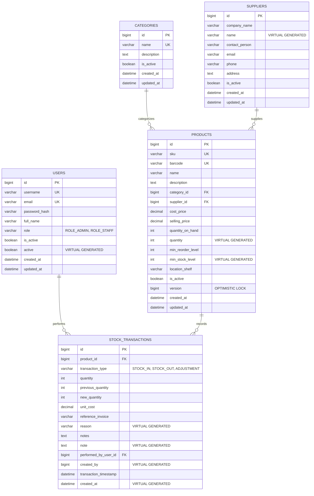

# Database Design & Schema Specification
## Smart Inventory Management Mobile Application

---

## 1. Database Overview

- **Database Engine**: MySQL 8.4 Community Server (InnoDB Storage Engine)
- **Database Schema**: `inventory_management`
- **Default Character Set**: `utf8mb4`
- **Default Collation**: `utf8mb4_unicode_ci`
- **Concurrency Isolation**: Read Committed (`@Transactional(isolation = Isolation.READ_COMMITTED)`) with pessimistic row-level write locks (`SELECT ... FOR UPDATE`)
- **Audit Policy**: Immutable append-only transaction ledger with foreign key delete restrictions (`ON DELETE RESTRICT`)

---

## 2. Entity-Relationship (ER) Diagram

---

## 3. Data Dictionary & Table Specifications

### 3.1. `users` Table
Stores administrative and staff accounts authorized to interact with the mobile application and REST backend.

| Column Name | Data Type | Nullable | Key / Default | Constraints & Description |
| :--- | :--- | :---: | :--- | :--- |
| `id` | `BIGINT` | No | `PRIMARY KEY` | Auto-incrementing identifier |
| `username` | `VARCHAR(50)` | No | `UNIQUE` | Unique user handle (e.g. `admin`, `staff`) |
| `email` | `VARCHAR(100)` | No | `UNIQUE` | Unique email for authentication |
| `password_hash` | `VARCHAR(255)` | No | - | BCrypt (work factor 12) encrypted hash |
| `full_name` | `VARCHAR(100)` | No | - | Full legal name of staff member |
| `role` | `VARCHAR(20)` | No | `'ROLE_STAFF'` | `CHECK (role IN ('ROLE_ADMIN', 'ROLE_STAFF'))` |
| `is_active` | `BOOLEAN` | No | `TRUE` | Account active status flag |
| `active` | `BOOLEAN` | No | `VIRTUAL` | `GENERATED ALWAYS AS (is_active) VIRTUAL` |
| `created_at` | `DATETIME(6)` | No | `CURRENT_TIMESTAMP(6)` | Timestamp of registration |
| `updated_at` | `DATETIME(6)` | Yes | `CURRENT_TIMESTAMP(6)` | Timestamp of last status update |

### 3.2. `categories` Table
Organizes products into logical inventory departments.

| Column Name | Data Type | Nullable | Key / Default | Constraints & Description |
| :--- | :--- | :---: | :--- | :--- |
| `id` | `BIGINT` | No | `PRIMARY KEY` | Auto-incrementing identifier |
| `name` | `VARCHAR(100)` | No | `UNIQUE` | Unique category name (e.g. `Electronics`) |
| `description` | `TEXT` | Yes | `NULL` | Department scope description |
| `is_active` | `BOOLEAN` | No | `TRUE` | Soft-delete status |
| `created_at` | `DATETIME(6)` | No | `CURRENT_TIMESTAMP(6)` | Creation timestamp |
| `updated_at` | `DATETIME(6)` | Yes | `CURRENT_TIMESTAMP(6)` | Last modification timestamp |

### 3.3. `suppliers` Table
Records vendor and distributor contact details for purchasing and stock replenishment.

| Column Name | Data Type | Nullable | Key / Default | Constraints & Description |
| :--- | :--- | :---: | :--- | :--- |
| `id` | `BIGINT` | No | `PRIMARY KEY` | Auto-incrementing identifier |
| `company_name` | `VARCHAR(150)` | No | - | Registered vendor entity name |
| `name` | `VARCHAR(150)` | No | `VIRTUAL` | `GENERATED ALWAYS AS (company_name) VIRTUAL` |
| `contact_person`| `VARCHAR(100)` | Yes | `NULL` | Name of primary sales representative |
| `email` | `VARCHAR(100)` | Yes | `NULL` | Procurement email address |
| `phone` | `VARCHAR(30)` | Yes | `NULL` | Contact phone number for reorders |
| `address` | `TEXT` | Yes | `NULL` | Physical warehouse / dispatch address |
| `is_active` | `BOOLEAN` | No | `TRUE` | Supplier active status flag |
| `created_at` | `DATETIME(6)` | No | `CURRENT_TIMESTAMP(6)` | Creation timestamp |
| `updated_at` | `DATETIME(6)` | Yes | `CURRENT_TIMESTAMP(6)` | Last update timestamp |

### 3.4. `products` Table
Core catalog table maintaining item master records, pricing, location, and stock on hand.

| Column Name | Data Type | Nullable | Key / Default | Constraints & Description |
| :--- | :--- | :---: | :--- | :--- |
| `id` | `BIGINT` | No | `PRIMARY KEY` | Auto-incrementing identifier |
| `sku` | `VARCHAR(50)` | No | `UNIQUE` | Unique Stock Keeping Unit code |
| `barcode` | `VARCHAR(100)` | Yes | `UNIQUE` | EAN-13, UPC, or Code-128 barcode |
| `name` | `VARCHAR(150)` | No | - | Item display title |
| `description` | `TEXT` | Yes | `NULL` | Detailed technical product specifications |
| `category_id` | `BIGINT` | No | `FK` | Foreign Key -> `categories(id)` (`ON DELETE RESTRICT`) |
| `supplier_id` | `BIGINT` | Yes | `FK` | Foreign Key -> `suppliers(id)` (`ON DELETE SET NULL`) |
| `cost_price` | `DECIMAL(10,2)`| No | `0.00` | `CHECK (cost_price >= 0)` |
| `selling_price`| `DECIMAL(10,2)`| No | `0.00` | `CHECK (selling_price >= 0)` |
| `quantity_on_hand`| `INT` | No | `0` | `CHECK (quantity_on_hand >= 0)` |
| `quantity` | `INT` | No | `VIRTUAL` | `GENERATED ALWAYS AS (quantity_on_hand) VIRTUAL` |
| `min_reorder_level`| `INT` | No | `10` | `CHECK (min_reorder_level >= 0)` |
| `min_stock_level` | `INT` | No | `VIRTUAL` | `GENERATED ALWAYS AS (min_reorder_level) VIRTUAL` |
| `location_shelf` | `VARCHAR(50)` | Yes | `NULL` | Physical aisle, rack, or shelf bin identifier |
| `is_active` | `BOOLEAN` | No | `TRUE` | Soft-delete status |
| `version` | `BIGINT` | No | `0` | Optimistic locking token (incremented by Hibernate) |
| `created_at` | `DATETIME(6)` | No | `CURRENT_TIMESTAMP(6)` | Creation timestamp |
| `updated_at` | `DATETIME(6)` | Yes | `CURRENT_TIMESTAMP(6)` | Last modification timestamp |

### 3.5. `stock_transactions` Table
Immutable audit ledger recording every inventory delta with historical quantity balances and user accountability.

| Column Name | Data Type | Nullable | Key / Default | Constraints & Description |
| :--- | :--- | :---: | :--- | :--- |
| `id` | `BIGINT` | No | `PRIMARY KEY` | Auto-incrementing ledger entry ID |
| `product_id` | `BIGINT` | No | `FK` | Foreign Key -> `products(id)` (`ON DELETE RESTRICT`) |
| `transaction_type` | `VARCHAR(20)` | No | - | `CHECK (transaction_type IN ('STOCK_IN', 'STOCK_OUT', 'ADJUSTMENT'))` |
| `quantity` | `INT` | No | - | `CHECK (quantity > 0)`: Moved units |
| `previous_quantity`| `INT` | No | - | `CHECK (previous_quantity >= 0)`: Prior balance |
| `new_quantity` | `INT` | No | - | `CHECK (new_quantity >= 0)`: Post balance |
| `unit_cost` | `DECIMAL(10,2)`| Yes | `NULL` | Unit procurement cost at time of intake |
| `reference_invoice`| `VARCHAR(100)`| Yes | `NULL` | External invoice, PO number, or dispatch note |
| `reason` | `VARCHAR(100)`| Yes | `VIRTUAL` | `GENERATED ALWAYS AS (reference_invoice) VIRTUAL` |
| `notes` | `TEXT` | Yes | `NULL` | Operational remarks or delivery notes |
| `note` | `TEXT` | Yes | `VIRTUAL` | `GENERATED ALWAYS AS (notes) VIRTUAL` |
| `performed_by_user_id`| `BIGINT` | No | `FK` | Foreign Key -> `users(id)` (`ON DELETE RESTRICT`) |
| `created_by` | `BIGINT` | No | `VIRTUAL` | `GENERATED ALWAYS AS (performed_by_user_id) VIRTUAL` |
| `transaction_timestamp`| `DATETIME(6)`| No | `CURRENT_TIMESTAMP(6)` | Exact execution timestamp |
| `created_at` | `DATETIME(6)`| No | `VIRTUAL` | `GENERATED ALWAYS AS (transaction_timestamp) VIRTUAL` |

---

## 4. Key Relational Constraints & Business Invariants

1. **Non-Negative Quantity Invariant**:
   - Guaranteed at the database layer via `CHECK (quantity_on_hand >= 0)` on `products`.
   - Guaranteed at the service layer in `StockService.java` via explicit balance check:
     $$\text{request.getQuantity()} \le \text{currentQuantityOnHand}$$
   - Any attempt to dispatch more stock than available triggers an `InsufficientStockException` and rolls back the transaction.

2. **Transaction Immutability**:
   - `stock_transactions` records are strictly append-only. No `UPDATE` or `DELETE` endpoints exist.
   - Foreign key constraints on `product_id` and `performed_by_user_id` use `ON DELETE RESTRICT` to prevent accidental loss of historical audit records.

3. **Optimistic & Pessimistic Concurrency Control**:
   - **Pessimistic Row Locking (`SELECT ... FOR UPDATE`)**: Applied during `recordStockIn` and `recordStockOut` via `ProductRepository.findByIdForUpdate(id)` to prevent race conditions during simultaneous mobile scans.
   - **Optimistic Locking (`@Version private Long version;`)**: Applied on product metadata updates to prevent lost updates when multiple administrators edit the same product concurrently.

4. **Category & Supplier Deletion Safeguards**:
   - Categories linked to active products cannot be deleted (`ProductRepository.existsByCategoryId(id)` triggers `InvalidOperationException`).
   - Suppliers linked to active products cannot be deleted (`ProductRepository.existsBySupplierId(id)` triggers `InvalidOperationException`). If deleted directly in SQL, foreign key cascade sets `supplier_id = NULL` preserving the product record.

---

## 5. Indexing & Query Optimization Strategy

| Index Name | Table | Columns | Optimization Target |
| :--- | :--- | :--- | :--- |
| `idx_product_sku` | `products` | `sku` | Instant $O(1)$ product lookup by SKU |
| `idx_product_barcode` | `products` | `barcode` | Instant camera scanner lookup |
| `idx_product_category` | `products` | `category_id` | Fast join and catalog category filtering |
| `idx_product_supplier` | `products` | `supplier_id` | Supplier directory join queries |
| `idx_product_name` | `products` | `name` | Rapid catalog text search queries |
| `idx_product_low_stock` | `products` | `quantity_on_hand`, `min_reorder_level` | Sub-millisecond evaluation of low-stock alerts |
| `idx_trx_product` | `stock_transactions`| `product_id` | Historical product movement audit retrieval |
| `idx_trx_user` | `stock_transactions`| `performed_by_user_id`| Staff audit trail and accountability tracking |
| `idx_trx_timestamp` | `stock_transactions`| `transaction_timestamp` | Time-range reports and dashboard daily activity |
